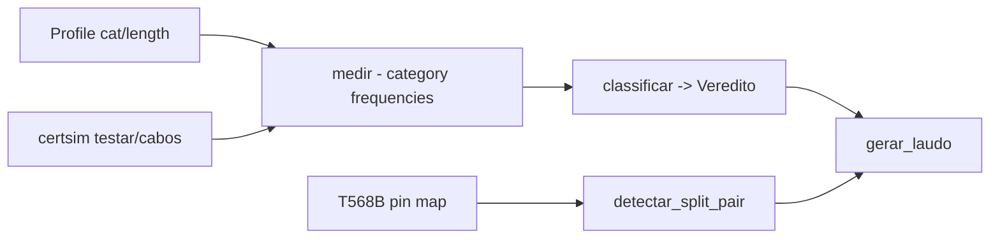

# certificador-cobre-simulado

**English** · [Português (Brasil)](README.md)

[](#) [](#) [](#) [](LICENSE)

## What it is

**A simulated copper-network cable certifier**: it measures the electrical parameters per **category** (Cat 5e/6/6A with their frequencies), checks the **pin map** (T568B, with **split-pair** detection) and classifies the result with a **verdict per parameter**, generating a textual **test report (laudo)**. Virtual equipment — the same logical flow as a field tester. It is an educational networking lab.

## Status

An educational lab, working and tested (84 tests). Measurements use a fixed seed (reproducible).

## Features

- **Measurement** (`medicao.py`): `Perfil` (category, length) + `medir(profile, seed=SEMENTE_FIXA)` — parameters per frequency (`frequencias_da`).
- **Pin map** (`mapa.py`): `mapa_padrao('T568B')`, `conferir_mapa` and `detectar_split_pair` (crossed pairs); `ErroDeMapa`.
- **Classification** (`classificador.py`): `classificar(profile, seed)` → `Veredito` (per parameter: pass/fail).
- **Report** (`laudo.py`): `gerar_laudo` — a textual result per cable with the equipment name (`_laudo_cabo`).
- **CLI** (`certsim`): `testar` (profile → report) and `cabos` (cable list from the scenario YAML).

## Architecture

A `certsim` package with `medicao` (parameters), `mapa` (pin maps), `classificador` (verdicts), `laudo` (output) and `cli.py`.



## Stack

- Python ≥ 3.10
- PyYAML ≥ 6.0 (only dependency)
- pytest (dev)

## Repository layout

```
certificador-cobre-simulado/
├── pyproject.toml · BRIEF.md
├── src/certsim/
│   ├── medicao.py · mapa.py · classificador.py
│   ├── laudo.py · cli.py
├── dados/             # cable scenarios (YAML)
├── tests/             # 84 tests
└── LICENSE            # MIT
```

## Prerequisites and installation

```bash
pip install -e .
```

## How to run

```bash
certsim testar dados/<profile>.yaml
certsim cabos dados/scenarios.yaml
```

## Tests and quality

Real command (verified by the agent):

```bash
PYTHONPATH=src python -m pytest tests/
# 84 passed
```

## Technical decisions and trade-offs

- **Simulation with a fixed seed**: reproducible reports (deterministic per call) — good for validating classification logic.
- **Per-category frequencies**: the model covers Cat 5e/6/6A on the main parameters (simplified NEXT/FEXT/attenuation).
- **T568B map + split pair**: catches the most common field miswiring.

## Known limitations and roadmap

- **Simulated** measurement (not real field equipment, e.g. Fluke DSX).
- Simplified parameters: it does not replace the full TIA-568 standard.

## Development process

An individual project by Kelvin Oliveira, built with orchestrated AI agents and reviewed by the author.

## License and author

MIT — Copyright (c) 2026 Kelvin Rebelo de Oliveira. Author: [Kelvin Oliveira](https://github.com/KelvinOliveiraCode) · [Portfolio](https://kelvinoliveiracode.github.io/portfolio/)
