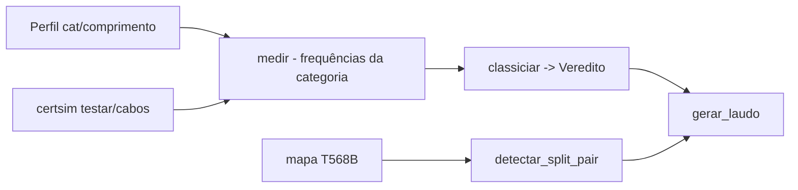

# certificador-cobre-simulado

[English](README.en.md) · **Português (Brasil)**

[](#) [](#) [](#) [](LICENSE)

## O que é

**Certificador de cabo de rede metálico (simulado)**: mede os parâmetros elétricos por **categoria** (Cat 5e/6/6A com suas frequências), confere o **mapa de pinagem** (T568B, com detecção de **split pair**) e classifica o resultado com **veredito por parâmetro**, gerando um **laudo** textual. Equipamento virtual — o mesmo fluxo lógico de um FieldTester. É um laboratório educacional de redes.

## Status

Laboratório educacional funcional e testado (84 testes). Medição com semente fixa (reprodutível).

## Funcionalidades

- **Medição** (`medicao.py`): `Perfil` (categoria, comprimento) + `medir(perfil, semente=SEMENTE_FIXA)` — parâmetros por frequência (`frequencias_da`).
- **Mapa de pinagem** (`mapa.py`): `mapa_padrao('T568B')`, `conferir_mapa` e `detectar_split_pair` (pares cruzados); `ErroDeMapa`.
- **Classificação** (`classificador.py`): `classificar(perfil, semente)` → `Veredito` (por parâmetro: passa/falha).
- **Laudo** (`laudo.py`): `gerar_laudo` — resultado textual por cabo com o nome do equipamento (`_laudo_cabo`).
- **CLI** (`certsim`): `testar` (perfil → laudo) e `cabos` (lista de cabos do cenário YAML).

## Arquitetura

Pacote `certsim` com `medicao` (parâmetros), `mapa` (pinagens), `classificador` (veredito), `laudo` (saída) e `cli.py`.



## Stack

- Python ≥ 3.10
- PyYAML ≥ 6.0 (única dependência)
- pytest (dev)

## Estrutura do repositório

```
certificador-cobre-simulado/
├── pyproject.toml · BRIEF.md
├── src/certsim/
│   ├── medicao.py · mapa.py · classificador.py
│   ├── laudo.py · cli.py
├── dados/             # cenários de cabos (YAML)
├── tests/             # 84 testes
└── LICENSE            # MIT
```

## Pré-requisitos e instalação

```bash
pip install -e .
```

## Como executar

```bash
certsim testar dados/<perfil>.yaml
certsim cabos dados/cenarios.yaml
```

## Testes e qualidade

Comando real (verificado pelo agente):

```bash
PYTHONPATH=src python -m pytest tests/
# 84 passed
```

## Decisões técnicas e trade-offs

- **Simulação com semente fixa**: laudos reprodutíveis (determinísticos por chamada) — bom para validar a lógica de classificação.
- **Frequências por categoria**: o modelo cobre Cat 5e/6/6A nos pontos principais (NEXT/FEXT/attenuation simplificados).
- **Mapa T568B + split pair**: detecta o erro de pincagem mais comum em campo.

## Limitações conhecidas e roadmap

- Medição **simulada** (não é equipamento real de campo, ex. Fluke DSX).
- Parâmetros simplificados: não substitui a norma TIA-568 completa.

## Processo de desenvolvimento

Projeto individual de Kelvin Oliveira, construído com agentes de IA orquestrados e revisado pelo autor.

## Licença e autor

MIT — Copyright (c) 2026 Kelvin Rebelo de Oliveira. Autor: [Kelvin Oliveira](https://github.com/KelvinOliveiraCode) · [Portfólio](https://kelvinoliveiracode.github.io/portfolio/)
